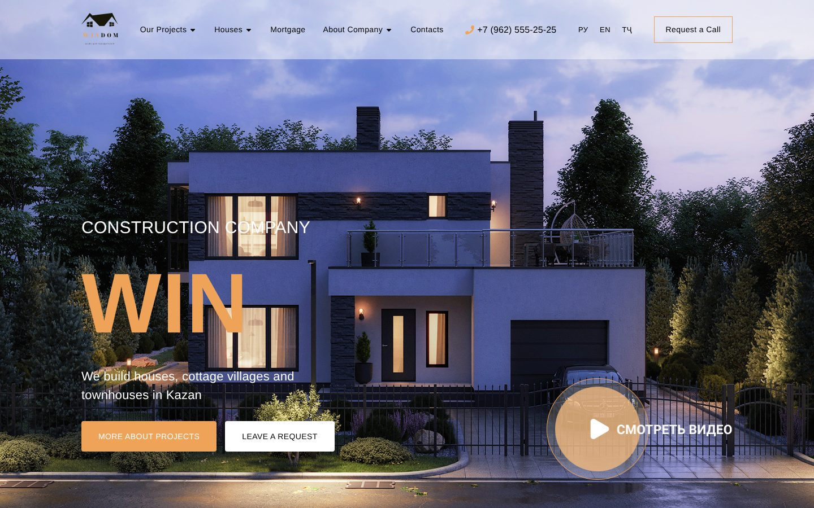

# WINDOM — сайт строительной компании

Многостраничный сайт строительной компании: коттеджные посёлки, каталог домов, ипотека, новости, команда и контакты. Вёрстка по макету, адаптив, три языка интерфейса (русский, английский, таджикский).




## Страницы

- **Главная** — первый экран, цифры компании, о компании, проекты, подбор ипотеки, команда, отзывы, новости и окно «Заказать звонок».
- **Проекты посёлков** — «Изумрудный», «Усадьба», «Зимний», «Константиновка» и другие.
- **Каталог домов** — одноэтажные, двухэтажные, таунхаусы, карточка дома.
- **Ипотека**, **Новости** и **СМИ о нас** со страницами статей, **Команда**, **Контакты**, страница 404.

## Что внутри

- **Маршрутизация** на React Router, каждая страница грузится лениво (`React.lazy`).
- **Мультиязычность** на i18next: переключатель РУ / EN / ТҶ в шапке.
- **Слайдеры** на Swiper, компоненты и иконки — MUI.

## Стек

React · Vite · React Router · MUI · i18next · Swiper · Axios

## Запуск

```bash
npm install
npm run dev     # http://localhost:5173
```
